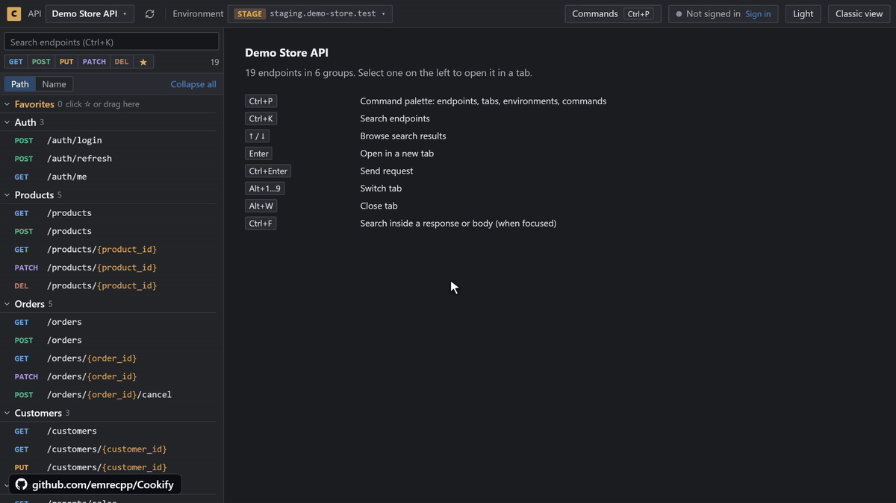
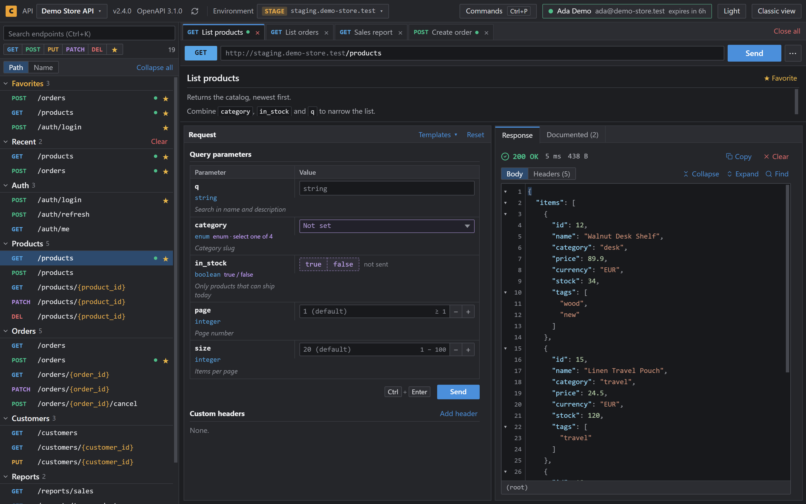
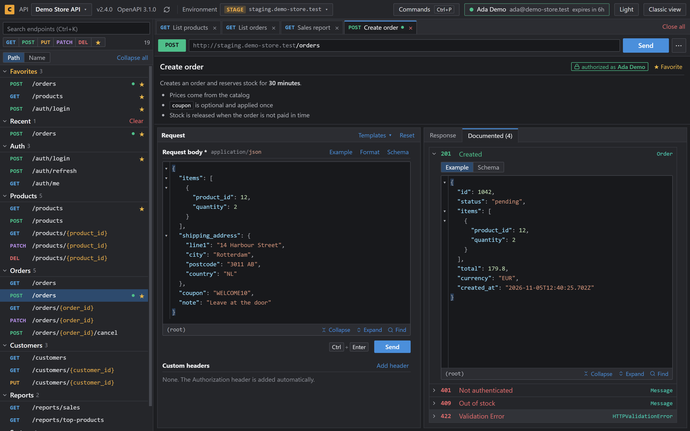
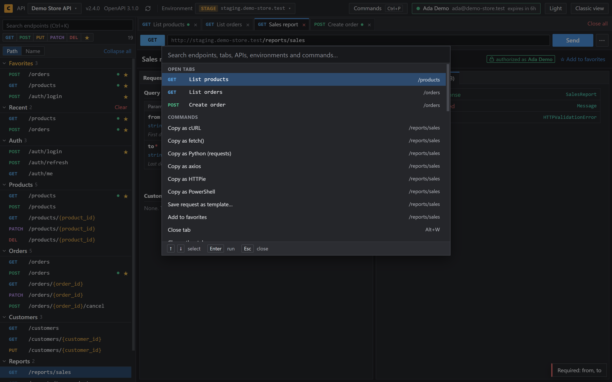
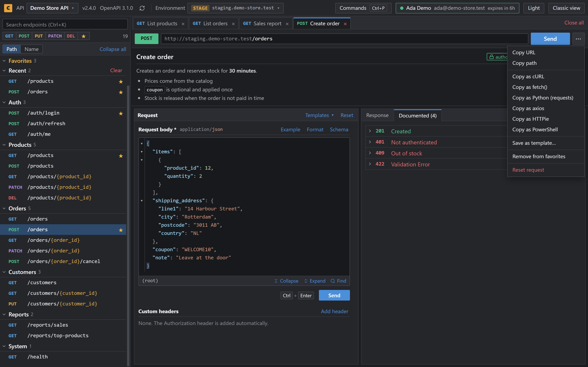
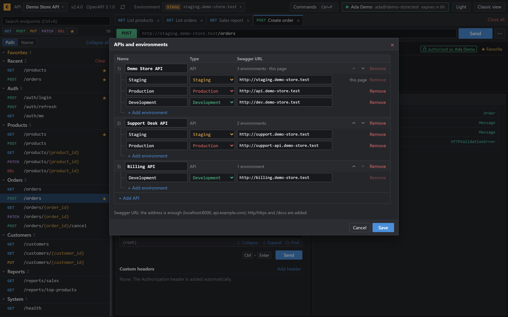
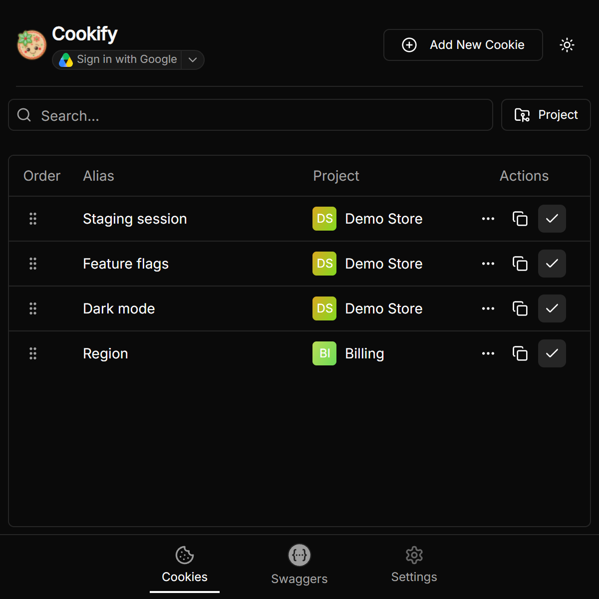
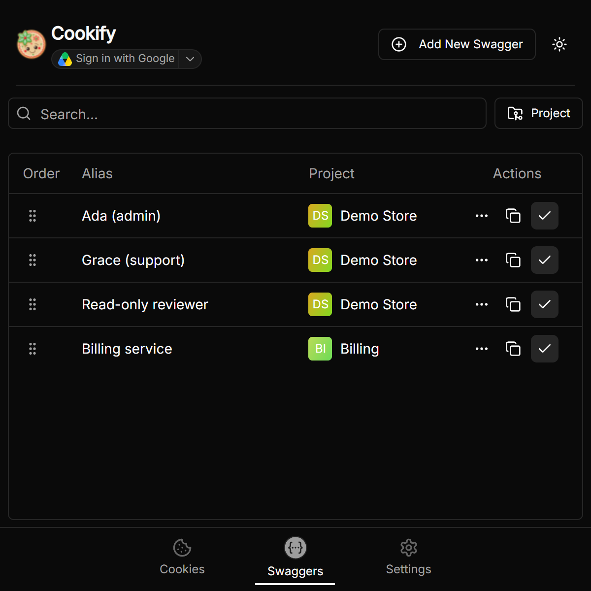
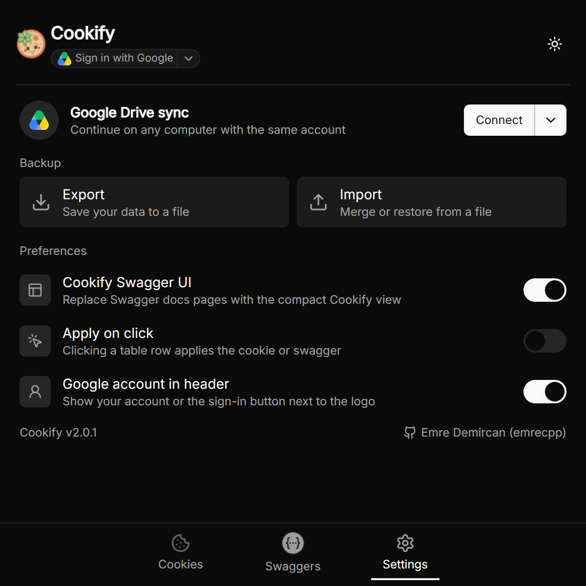

<p align="center">

</p>

<h1 align="center">Cookify: Postman-like API client for Swagger UI</h1>

<p align="center">
<b>Open your Swagger docs and start working.</b><br>
Tabs, environments, saved tokens and dark mode on every Swagger UI page. No import, no setup.<br>
<sub>Made by <a href="https://github.com/emrecpp">emrecpp</a></sub>
</p>

<p align="center">
<a href="https://chromewebstore.google.com/detail/cookify/mafdkfnimilggjneibkjfejlnhcecnjd"></a>
<a href="LICENSE"></a>

</p>

<p align="center">

</p>

<p align="center">
<a href="screenshots/demo.mp4">Watch the full demo (48 seconds)</a> · <a href="https://emrecpp.github.io/Cookify/">Website</a>
</p>

If Cookify saves you time, a ⭐ helps other developers find it.

## Why Cookify?

Swagger UI is on almost every API, but it wasn't built for working all day. Postman is, but you have to import your API and keep it up to date. Cookify turns the Swagger UI page you already have into a fast API client.

- **Nothing to import**: Endpoints, schemas and examples come from the page, and API changes are marked.
- **Nothing to set up on the server**: It works on any API you can open, including ones you don't own.
- **Made for daily work**: Tabs, saved request bodies, and Development, Staging and Production with a token for each.
- **Private by default**: No account and no analytics. Requests go straight from your browser to your API.

## 🧭 Swagger View

Cookify shows Swagger UI pages in its own view. **Classic view** in the header brings back the original page at any time.

### Send requests
- **Tabs**: Keep several endpoints open and switch with `Alt+1…9`.
- **Forms and JSON editor**: Fields fit each parameter's type, and request bodies start from the schema's example.
- **Validation**: Send points out missing or invalid values.
- **Responses**: Read the response next to your request, with every documented response colored by status code.
- **Templates and history**: Save requests and return to recent endpoints.

<p align="center">


</p>

### Find anything fast
- **Command palette**: `Ctrl+P` searches endpoints, tabs, APIs, environments and commands.
- **Search and favorites**: `Ctrl+K` searches the list, and you can filter it by method or favorites.
- **Code snippets**: Copy a request as cURL, fetch(), Python, axios, HTTPie or PowerShell.
- **Postman export**: Export all endpoints or only your favorites as a collection.

<p align="center">


</p>

### Work across APIs and environments
- **Saved APIs and environments**: Move between Development, Staging and Production and keep your favorites, tabs and drafts.
- **Sessions**: Log in with the API's OAuth2 password flow or pick a saved token. Each environment keeps its own.
- **API changes**: New, changed and removed endpoints are marked in the list.

<p align="center">

</p>

## ✨ Popup Features

<p align="center">



</p>

- **Cookies**: Add, save and filter cookies, and apply them to a site with one click.
- **JWT tokens**: Save tokens and apply them to Swagger with one click.
- **Projects**: Group and filter cookies and tokens by project.
- **Profiles**: Export everything to one compressed file, encrypted with AES-256 if you set a password, then merge or replace it on another machine.
- **Google Drive sync**: Sign in on another computer and continue where you left off, including the endpoints you had open. Cookify can access only its own hidden app folder in your Drive.

## Cookify, Swagger UI and Postman

| | Swagger UI | Postman | Cookify |
|---|:---:|:---:|:---:|
| Works on your docs page with no import | ✅ | ❌ | ✅ |
| Follows API changes on its own | ✅ | ❌ | ✅ |
| Several endpoints open in tabs | ❌ | ✅ | ✅ |
| Environments (dev, staging, production) | ❌ | ✅ | ✅ |
| Saved tokens per environment | ❌ | ✅ | ✅ |
| Collections, test scripts and mock servers | ❌ | ✅ | ❌ |

Need full test suites and team workspaces? Postman is the better fit, and Cookify can export your endpoints as a Postman collection.

## Works with

Cookify runs on Swagger UI pages and reads both Swagger 2.0 and OpenAPI 3.x documents.

| Stack | Library | Usual address |
|---|---|---|
| **FastAPI** | Built in | `/docs` |
| **NestJS** | `@nestjs/swagger` | `/api` |
| **Express** | `swagger-ui-express` | `/api-docs` |
| **ASP.NET Core** | Swashbuckle | `/swagger` |
| **Spring Boot** | springdoc-openapi | `/swagger-ui/index.html` |
| **Anything else** | Swagger UI | Any page that runs it |

If Cookify can't find the API document on a page, the original Swagger UI stays as it is.

## ❓ FAQ

**Is Cookify a Postman alternative?**
For calling and checking an API that has Swagger docs, yes. It doesn't replace Postman's collections, test scripts or mock servers.

**Does it change my API or my server?**
No. Cookify runs only in your browser, so there's nothing to install on the server.

**How do I get dark mode in Swagger UI?**
Install Cookify. Its view is dark by default on every Swagger UI page, and you can switch to light from the header.

**Can I go back to the original Swagger UI?**
Yes. **Classic view** in the header brings it back for that page, and **Cookify view** returns.

**Does it work with Redoc or Scalar?**
Not yet. Cookify works on pages that run Swagger UI.

**Where is my data stored?**
In your browser. Google Drive sync is optional and uses a private app folder in your own Drive. See the [Privacy Policy](https://emrecpp.github.io/Cookify/privacy/).

## 🚀 Development

Built with React, TypeScript and Vite.

```
git clone https://github.com/emrecpp/Cookify.git
cd Cookify
npm install
npm run dev
```

Then open `chrome://extensions/`, enable **Developer Mode**, click **Load Unpacked** and select the `dist` folder.

<details>
<summary>Google Drive OAuth setup</summary>

Google Drive sync is optional and disabled unless the user connects an account from Settings. To enable the Connect button in a build:

1. Enable the Google Drive API in a Google Cloud project.
2. Create an OAuth 2.0 client for a Chrome extension and bind it to the Cookify extension ID. The published ID is `mafdkfnimilggjneibkjfejlnhcecnjd`; unpacked development builds may use a different stable ID.
3. Create a Web application OAuth client for account switching and add `https://<extension-id>.chromiumapp.org/google-oauth` to its authorized redirect URIs.
4. Copy `.env.example` to a local `.env.development` or `.env.production` file. It holds the public client IDs of the published extension; for a build with another extension ID, put your own there:

   ```env
   VITE_GOOGLE_OAUTH_CLIENT_ID=your-chrome-extension-client-id.apps.googleusercontent.com
   VITE_GOOGLE_OAUTH_WEB_CLIENT_ID=your-web-client-id.apps.googleusercontent.com
   ```

5. Run `npm run build` and load `dist` in Chrome.

Cookify requests only `https://www.googleapis.com/auth/drive.appdata`. This hidden area is accessible to Cookify but does not grant access to the user's other Drive files. OAuth client IDs are public identifiers; never add a client secret to the extension.

</details>

## 🤝 Contributing

Fork the repository, create a branch and open a pull request that describes your changes.

## 📜 Author and license

Cookify is created and maintained by Emre Demircan ([emrecpp](https://github.com/emrecpp)). The official sources are [this repository](https://github.com/emrecpp/Cookify) and the [Chrome Web Store listing](https://chromewebstore.google.com/detail/cookify/mafdkfnimilggjneibkjfejlnhcecnjd).

Licensed under the [MIT License](LICENSE). Copies and forks must keep the copyright notice: © 2025 Emre Demircan ([emrecpp](https://github.com/emrecpp)).
