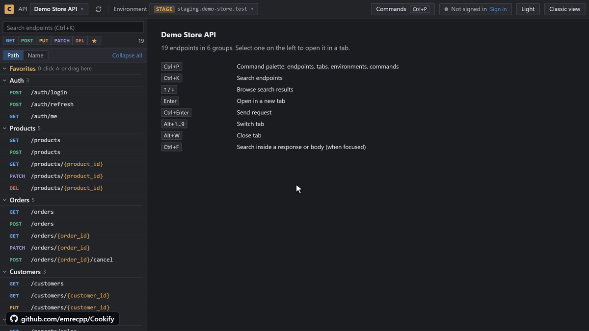

Cookify 2.0 turns any Swagger UI page into a Postman-like API client. Open your API docs as usual: your endpoints, schemas and examples are already there, with nothing to import and nothing to set up on the server.

**[Install from the Chrome Web Store](https://chromewebstore.google.com/detail/cookify/mafdkfnimilggjneibkjfejlnhcecnjd)** · [Website](https://emrecpp.github.io/Cookify/)

## New in 2.0

- **Swagger view**: Any Swagger UI page opens in a compact workspace with tabs, favorites, a command palette (`Ctrl+P`) and dark and light themes. Classic view brings back the original page at any time.
- **Requests**: Fields that fit each parameter's type, a JSON editor for request bodies, and missing or invalid values pointed out before you send.
- **Responses**: Read the response next to your request, with every documented response colored by status code.
- **APIs and environments**: Save an API once and move between Development, Staging and Production with its own favorites, tabs, drafts and token.
- **Sessions**: Sign in from the page, see who you are and when the token expires.
- **API changes**: New, changed and removed endpoints are marked when the API changes.
- **Code snippets and export**: Copy a request as cURL, fetch(), Python, axios, HTTPie or PowerShell, or export the endpoints as a Postman collection.
- **Google Drive sync**: Continue on another computer where you left off, including the endpoints you had open.
- **Backups**: Export and import everything in one compressed file, encrypted if you set a password.
- **Popup**: Dark theme by default and a simpler Settings page, with sync and backups at the top.

## New in 2.0.2

- **File uploads to any server**: JSON, form data and file uploads now reach APIs on other domains without CORS errors.
- **Copy from the response**: Click a value in a response to copy it or its JSON path. Selecting text works as before.
- **Error responses stand out**: 4xx and 5xx response bodies are shown in a coral color.
- **Lighter on other sites**: The Cookify view loads only on Swagger UI pages. Pages that just contain the words "swagger-ui", such as a search box or a blog post, are no longer touched.
- **Saved cookies and tokens**: Dragging a row while the list is filtered keeps the hidden rows in place, and search also finds cookies by alias.

## Privacy

There is no account, no analytics and no Cookify server. Requests go straight from your browser to your API. Google Drive sync is optional and uses a private app folder in your own Drive. See the [privacy policy](https://emrecpp.github.io/Cookify/privacy/).

**Full changelog**: https://github.com/emrecpp/Cookify/compare/v1.2.2...v2.0.2
